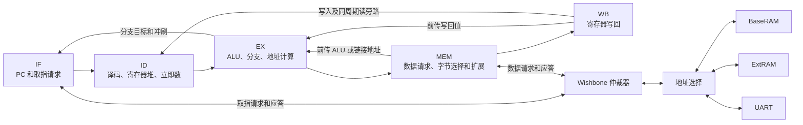

# Lab6 基础版设计与验证

适用组别为 `cod26-grp56`。目标器件为 ThinPAD 的 `xc7a100tfgg676-2L`，运行时钟为 10 MHz。基础版运行 32 位监控程序 Ver.1，支持监控程序要求的 19 条 RV32I 指令、Lab1 计算进位所用的 `SLTU` 以及三条 Bitmanip 0.92 指令。

## 处理器结构



| 流水寄存器 | 保存内容 |
|---|---|
| IF/ID | 有效位、PC、指令 |
| ID/EX | PC、指令、源寄存器编号和数据、目标寄存器、立即数、控制信号 |
| EX/MEM | 地址或运算结果、写入内存的数据、访存与写回控制 |
| MEM/WB | 访存或运算结果、目标寄存器和写回使能 |

EX 优先使用 EX/MEM 中较新的非 load 结果，再检查 MEM/WB。WB 与 ID 同周期读写时也直接旁路。若 EX 因较老的访存事务暂停，先保存即将离开 WB 的操作数。等 MEM 收到应答后再继续执行。寄存器 `x0` 始终读出零。

例如 `lw a6, 0(s0)` 后紧跟 `add a7, a6, a1`。假定 IF 和 MEM 单周期完成，`add` 在 ID 保留一拍，并向 EX 插入一个气泡。`lw` 的数据到达 WB 后，`add` 在 EX 直接使用该值。

| 指令或气泡 | 周期 1 | 周期 2 | 周期 3 | 周期 4 | 周期 5 | 周期 6 | 周期 7 |
|---|---|---|---|---|---|---|---|
| `lw` | IF | ID | EX | MEM | WB | | |
| `add` | | IF | ID | ID | EX | MEM | WB |
| 气泡 | | | | EX | MEM | WB | |

EX 判定分支和跳转。在重定向时清空 IF/ID，已发出的取指请求等应答结束，再丢弃数据。Wishbone 仲裁器接收独立的 IF 和 MEM Master，在同周期发起新请求时优先 MEM。当前事务保持到 ACK，只有对应的 Master 收到 ACK。UART 状态地址 `0x1000_0005` 使用字节选择 `0010`。系统检测到不支持的指令时停止取指，LED15 置位。

## 三条位操作指令

| 指令 | 译码匹配值 | 掩码 | 结果 |
|---|---|---|---|
| SBSET | `0x28001033` | `0xfe00707f` | 置位 `rs2[4:0]` 指定的位 |
| SBCLR | `0x48001033` | `0xfe00707f` | 清零 `rs2[4:0]` 指定的位 |
| CLZ | `0x60001013` | `0xfff0707f` | 计算从最高位开始的连续零位数。输入为零时写回 32 |

三条指令在 EX 执行。CLZ 逐级选择非零的半字、字节、四位组和二位组。测试使用机器码固定 0.92 编码，并在前后插入依赖指令。

## 构建和仿真

从仓库根目录执行。将示例路径替换为本机工具目录和课程监控程序的 `kernel` 目录。

```powershell
python scripts/build_images.py --toolchain-dir "D:/path/to/rv-2025/toolchain/bin" --monitor "D:/path/to/rv-2025/supervisor-rv/kernel"
python scripts/run_sim.py --vivado-bin "D:/path/to/Vivado/2024.2/bin"
vivado -mode batch -source scripts/build_vivado.tcl -log build/vivado-build.log -journal build/vivado-build.jou
```

监控程序镜像使用 RV32 基础配置和轮询 UART。在 FPGA 上使用实验提供的最小 UART 实现，因此生成镜像时关闭 16550 初始化、中断、分页和 FENCE.I。课程源码由 `--monitor` 指定，构建产物在 `build/images/`。

| 验证 | 通过条件和结果 |
|---|---|
| 核心 | 三种应答时序均通过。零等待模式触发 2 次 load-use。延迟取指模式丢弃 5 个重定向前发出的取指。数据等待模式验证了 WB 离开时保留前传值。 |
| Wishbone | 验证并发请求、保持当前事务、MEM 优先和应答归属。 |
| Lab5 求和 | 真实 SRAM 控制器和串口模型输出 `done!`，BaseRAM 偏移 `0x100` 为 5050。 |
| Ver.1 和用户程序 | 在 115200 波特的串口模型上完成启动和 Term 的 A、D、G、R 协议。Lab1 验收程序得到前十项 Fibonacci、精确的 F60 和 94 个可见 ASCII 字符。grp56 的四个结果为 `80000000`、`00000000`、`00000020`、`0000001f`。 |
| 监控程序测例 | 原始 UTEST_SIMPLE 通过。1PTB、2DCT、3CCT、4MDCT 在仿真 SRAM 中暂时缩为三次循环并通过。生成的监控程序保留课程原始循环次数。 |
| FPGA | Vivado 完成综合、布局布线和 bitstream 生成。继承实验约束，内部时序路径均受约束，外部引脚未另设输入输出延时。 |

核心波形在 `build/xsim/core-0.wdb`、`core-1.wdb` 和 `core-2.wdb`。查看 `dut.load_use`、`dut.id_ex`、`dut.ex_mem`、`dut.mem_wb`、`dut.ex_rs1`、`dut.redirect` 及取指请求和应答。上板文件在 `build/vivado/lab6.runs/impl_1/thinpad_top.bit`。布线后的时序、资源和 DRC 报告在 `build/vivado/`。

## ThinPAD 上板验收

1. 加载本项目的 bit 文件。将 `build/images/monitor.bin` 写入 BaseRAM 字节偏移 `0x0`。
2. 将 DIP0 置零进入连续运行。直连 UART 使用 115200、8N1。复位后检查 `MONITOR for RISC-V - initialized.`。DIP0 置一时，BTN5 每次按下推进一个时钟周期，用于单步观察 LED 显示的取指 PC 低位。
3. 用 Term 写入用户程序、读回、执行和检查结果。用户程序装入 CPU 地址 `0x8010_0000`，对应 BaseRAM 偏移 `0x100000`。Lab1 三个入口见 `build/images/lab1-entries.mem`。grp56 程序入口为 `0x8010_0000`，结果区为 `0x8040_0100`。
4. 从 `build/images/monitor-tests.txt` 取原始监控程序测例入口。测试后记录 Term 输出和内存结果，再补齐上板截图与测例记录。

本地仿真和 FPGA 实现已完成。真实板卡需登录 ThinPAD-Cloud 后验收。完整的长循环和 CryptoNight 上板结果待记录。

## 思考题

1. 多周期 CPU 让一条指令用多个周期完成，各条指令依次执行，可复用运算和访存部件。流水线把这些阶段并行起来。数据就绪时，旁路可以让下一条指令及时使用结果。若只等待寄存器写回，相关指令会多停几个周期。对紧邻的 load-use，数据直到 MEM 才可用，仍需要气泡或总线等待。
2. 可将 Flash 控制器映射为只读外设。复位从一段片上 Boot ROM 取指。引导代码按固定 Flash 地址读取镜像，用 store 指令顺序写入 BaseRAM，写完后跳转到镜像入口。需要保证 Flash 读事务能正确等待，地址选择同时覆盖启动 ROM、Flash 和 BaseRAM。
3. 把字符显存映射到处理器可写地址，用字模 ROM 把字符编码和扫描行转换成像素。像素时钟驱动行列计数，产生同步及显示有效信号。DVI 输出端把像素和消隐控制转换为 TMDS，并通过差分线路输出数据和时钟。

本阶段在同一会话中独立完成 RTL、集成和本地验证。
